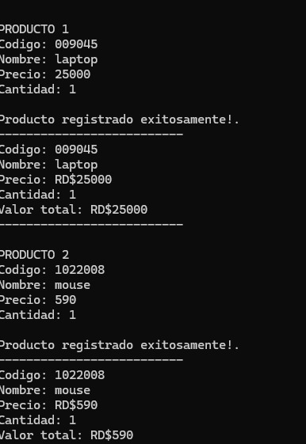
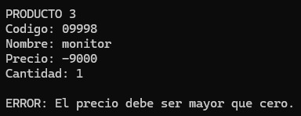
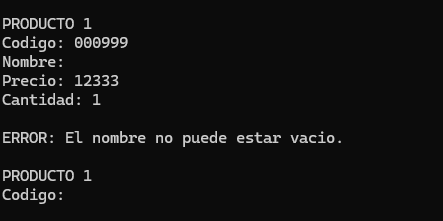

 Control de Inventario – TecnoPunto

 Datos del estudiante
- Nombre: Marlon de la Cruz
- Matrícula: 2024-2910
- Asignatura: Programación Básica
- Profesor: Gamalier Reyes del Carmen

 Descripción del proyecto
Este programa fue desarrollado en C# utilizando Visual Studio Community. Su objetivo es llevar un control básico de los productos de la tienda TecnoPunto.

Permite registrar tres productos, mostrar sus datos y calcular el valor total de cada uno. También verifica que la información ingresada sea correcta para evitar errores.

 Funcionamiento del programa

Datos de entrada:
- Código y nombre del producto.
- Precio y cantidad disponible.

Datos que procesa:
- Comprueba que el nombre no esté vacío.
- Verifica que el precio sea mayor que cero.
- No permite cantidades negativas.
- Calcula el valor total multiplicando el precio por la cantidad.

Datos de salida:
- Información de cada producto registrado.
- Precio, cantidad y valor total.
- Mensajes cuando se introduce un dato incorrecto.

 Conceptos utilizados
Se aplicaron clases, objetos, propiedades, constructores, métodos, ciclos y manejo de errores mediante `try` y `catch`.

El programa está organizado en dos archivos principales: `Producto.cs` y `Program.cs`.

Capturas del programa

1. Registro con datos válidos

2. Validación de precio negativo

3. Validación de nombre vacío

4. Registro con cantidad cero

[Cantidad cero](capturas/cantidad-cero.png)

 Conclusión
Esta práctica me permitió comprender mejor cómo trabajar con clases y objetos en C#, utilizar propiedades para validar información y organizar el código de un programa de consola.
